# Laporan Tugas Instance Segmentation

| Keterangan | Detail |
|---|---|
| **Mata Kuliah** | Computer Vision |
| **Nama / NRP** | Tri Ismunhadi Julik Cakra Wibawa / 5054241017 |
| **Tanggal** | 25 November 2026 |
| **Dataset Training** | `panoptic-indoor-segmentation` (Roboflow v1 forked v5, 922 gambar, 74 kelas, 11.845 instance poligon) |
| **Test Set Buatan Sendiri** | `myroom/` (40 foto kamera HP, 326 instance poligon beranotasi mandiri pada 23 kelas terpetakan) |
| **Notebook Utama** | [`train_instance_segmentation3.ipynb`](train_instance_segmentation3.ipynb), [`train_augmentation.ipynb`](train_augmentation.ipynb), [`inference_evaluation.ipynb`](inference_evaluation.ipynb) |

---

## Ringkasan Eksekutif

Laporan ini mendokumentasikan studi *instance segmentation* secara menyeluruh (*end-to-end*) yang mencakup **tiga keluarga arsitektur** (**YOLO11n-seg**, **Mask R-CNN ResNet-50-FPN v2**, dan **Mask2Former Swin-Tiny**) serta **eksperimen terkontrol tiga tingkat augmentasi** (**No Aug**, **Aug 1**, **Aug 2**), yang dievaluasi pada *validation split* asli Roboflow (`166` gambar) dan **test set dalam ruangan buatan sendiri beranotasi mandiri sebanyak 40 gambar (`myroom/`)**.

Temuan utama:
1. **Bagian 1 — Perbandingan Model (`512 × 512`):** Pada *validation set* asli, **Mask2Former (Swin-T)** menempati peringkat ke-1 (`mAP@50-95 = 0.1485`, `mAP@50 = 0.2663`). Namun, di bawah kondisi *domain shift* dunia nyata pada `myroom/`, **Mask R-CNN (R50-FPN)** meraih akurasi Bagian 1 tertinggi (`mAP@50-95 = 0.0740`, `mAP@50 = 0.1653`) dengan **penurunan performa relatif paling kecil (`-37.0%`)**, yang sebagian memvalidasi hipotesis sebelum eksperimen.
2. **Bagian 2 — Studi Augmentasi (`640 × 640`, Mask2Former Swin-T):** Augmentasi berat (**Aug 2**) berhasil mencegah *overfitting* parah yang terjadi pada **No Aug** (*validation loss* melonjak dari `50.74` pada epoch 8 menjadi `76.73` pada epoch 50) dan **Aug 1** (`49.31` → `62.53`), sehingga meraih **performa terbaik secara keseluruhan** baik pada `val` asli (`mAP@50-95 = 0.2108`, `mAP@50 = 0.3719`) maupun pada `myroom/` (`mAP@50-95 = 0.0958`, `mAP@50 = 0.2257`).
3. **Akar Penyebab *Domain Shift*:** Penghitungan jumlah kelas pada *training set* mengungkap bahwa 6 dari 23 kelas di `myroom/` hanya memiliki **0–3 instance** pada *training split* yang berisi 397 gambar (`keyboard=0`, `mouse=0`, `refrigerator=2`, `wall=2`, `backpack=3`, `curtain=3`), yang mencakup **~20% dari seluruh objek *ground truth* `myroom/`** dan memicu kesalahan klasifikasi sistematis `wall → wall-other-merged` (`2` berbanding `756` instance latih).
4. **Analisis Kegagalan Berbasis Bukti & Eksperimen Pembuktian:** Audit menyeluruh terhadap 40 foto `myroom/` pada model terbaik Bagian 1 (`Mask R-CNN`) dan model terbaik Bagian 2 (`Mask2Former Aug 2`), pembedahan 5 studi kasus kegagalan yang beragam, serta pelaksanaan 3 eksperimen pembuktian kecil mengonfirmasi bagaimana mekanisme arsitektur (**grid mask `28×28` RoIAlign**, **klasifikasi kotak lokal**, **duplikasi *query* Hungarian tanpa NMS**, dan **hilangnya resolusi akibat *downscaling***) memengaruhi kegagalan di dunia nyata.

---

## 1. Test Set Buatan Sendiri (`myroom/`) & Analisis *Domain Shift*

*(Komponen Rubrik 1: Minimal 40 foto ruangan nyata dari kamera HP sendiri, ≥10 foto kondisi sulit, anotasi mandiri di Roboflow, EXIF/metadata, performa dataset asli vs buatan sendiri, dan analisis domain shift.)*

### 1.1 Protokol Pengambilan Data & Metadata EXIF

Seluruh **40 gambar uji** diambil langsung pada ruangan nyata (kamar tidur, meja kerja/komputer, dan area dapur) menggunakan kamera ponsel pribadi pada **17 November 2026** (`18:24:46–18:43:37 WIB`). Foto mentah asli diarsipkan dalam `myfoto.zip` dengan *header* EXIF yang utuh.

| Atribut EXIF / Pengambilan Foto | Nilai (dari 40 foto mentah pada `myfoto.zip`) |
|---|---|
| **Merek / Model Kamera** | `samsung` / `SM-A236E` (Samsung Galaxy A23 5G) |
| **Bukaan (*Aperture*) / *Focal Length*** | `f/1.8` / `4.0 mm` (konsisten pada seluruh 40 foto) |
| **Rentang Waktu Pengambilan** | `2026:11:17 18:24:46` – `2026:11:17 18:43:37` |
| **Resolusi (setelah orientasi EXIF)** | `4080 × 3060` lanskap (16), `3060 × 4080` potret / `EXIF=6` (20), `4080 × 2296` layar lebar 16:9 (4) |
| **Rentang ISO (min / median / maks)** | `100` / `400` / `2000` |
| **Rentang *Shutter Speed*** | `0.02 dtk` (`1/50 dtk`) – `0.25 dtk` (`1/4 dtk`) |

#### Sampel Data EXIF (Foto Kondisi Sulit & Standar Terpilih)

| Indeks | Nama File | Ukuran Terorientasi | EXIF Orient | ISO | Eksposur (dtk) | Waktu Ambil | Kondisi / Catatan Adegan |
|---:|---|---:|---:|---:|---:|---|---|
| `01` | `20261117_182448.jpg` | `4080 × 2296` | `1` | `320` | `0.03` | `18:24:50` | Kamar tidur 16:9 *widescreen*, tepi kasur & lemari terpotong |
| `05` | `20261117_182752.jpg` | `4080 × 3060` | `1` | `2000` | `0.25` | `18:27:59` | **Cahaya sangat redup** (ISO maks 2000, *shutter* `1/4 dtk`) |
| `07` | `20261117_182834.jpg` | `4080 × 3060` | `1` | `1250` | `0.06` | `18:28:36` | **Cahaya redup**, oklusi meja & tirai |
| `12` | `20261117_183045.jpg` | `3060 × 4080` | `6` | `400` | `0.03` | `18:30:46` | **Sudut miring tinggi (*oblique*)**, kasur tertutup selimut kusut |
| `17` | `20261117_183141.jpg` | `4080 × 3060` | `1` | `500` | `0.04` | `18:31:42` | **Redup & *top-down* padat** (mouse hitam di atas mousepad hitam, keyboard terpotong) |
| `19` | `20261117_183329.jpg` | `3060 × 4080` | `6` | `400` | `0.04` | `18:33:31` | **Sudut diagonal ekstrem**, laptop + botol berantakan di belakang |
| `23` | `20261117_183849.jpg` | `3060 × 4080` | `6` | `250` | `0.02` | `18:38:50` | **Objek sangat padat & bertumpuk** (30 instance GT, dominan sendok) |
| `26` | `20261117_183922.jpg` | `3060 × 4080` | `6` | `2000` | `0.25` | `18:39:28` | **Cahaya sangat redup + objek padat** (12 objek GT, ISO 2000) |
| `27` | `20261117_183934.jpg` | `4080 × 3060` | `1` | `2000` | `0.25` | `18:39:38` | **Cahaya sangat redup** di meja dapur (ISO 2000, `1/4 dtk`) |
| `35` | `20261117_184220.jpg` | `3060 × 4080` | `6` | `1250` | `0.24` | `18:42:24` | **Cahaya sangat redup**, *shutter* lambat (`0.24 dtk`, ISO 1250) |
| `36` | `20261117_184238.jpg` | `3060 × 4080` | `6` | `500` | `0.04` | `18:42:40` | **Ruangan gelap gulita + silau layar laptop** (rentang dinamis ekstrem) |

#### Cakupan Kondisi Sulit (Syarat: ≥ 10 foto)
Test set 40 foto ini melampaui syarat minimal 10 foto kondisi sulit melalui berbagai tantangan yang saling beririsan:
- **Pencahayaan redup / *low-light*:** **11 foto** dengan `ISO ≥ 500` (termasuk **5 foto** pada `ISO 1250–2000` dengan *shutter* `0.06–0.25 dtk`: indeks `05, 07, 26, 27, 28, 35`) ditambah **1 adegan gelap total dengan layar menyala (*backlit glare*)** (`36`).
- **Risiko *motion blur* dari *shutter* lambat:** **17 foto** dengan waktu eksposur `≥ 0.04 dtk`.
- **Oklusi berat & kepadatan objek tinggi:** **10+ foto** yang memuat `10–30` objek yang rapat dan saling menutupi (misalnya `23` dengan 30 objek, `30` dengan 20, `38` dengan 18, `18/29/31` dengan 13, `26` dengan 12, serta `00/10` dengan 10 objek).
- **Sudut kamera non-kanonis & ekstrem:** Bidikan meja dari atas (*top-down*) (`17, 19, 36`), sudut miring curam pada kasur/dapur (`12, 23`), serta variasi rasio aspek 20 potret (`3:4`) dan 4 layar lebar (`16:9`).

### 1.2 Anotasi Roboflow & Penyelarasan Taksonomi

Ke-40 foto dianotasi secara manual di Roboflow (`myroom/`, diekspor pada 24 November 2026 dalam format poligon/OBB YOLOv8, menghasilkan **326 instance poligon** pada **24 nama kelas**; tersisa `306` mask valid non-degenerat pada `512px` dan `308` pada `640px` setelah proses *letterboxing*).

**Detail Rekayasa Penting — Penyelarasan ID Kelas & Orientasi EXIF:**
1. **Pemetaan ulang nama kelas (*class-name remapping*):** Roboflow mengekspor `myroom/data.yaml` dengan indeks ulang `0..23`, sedangkan seluruh 6 model terlatih mengeluarkan indeks 74 kelas (`0..73`) dari `panoptic-indoor-segmentation`. Di dalam [`inference_evaluation.ipynb`](inference_evaluation.ipynb), setiap poligon *ground truth* dipetakan otomatis berdasarkan **nama kelas** ke taksonomi latih 74 kelas, dengan `CLASS_ALIAS_MAP = {"table": "table-merged"}` yang menyatukan 22 instance `table` ke `table-merged` (kelas 54), menghasilkan **23 kelas evaluasi aktif**.
2. **Pemulihan orientasi EXIF:** Karena Roboflow mengekspor `myroom/` tanpa *Auto-Orient* dan menghapus *header* EXIF, 20 foto potret (`EXIF Orient=6` di `myfoto.zip`) memiliki piksel miring `4080×3060` sementara koordinat poligon berada pada posisi tegak. Fungsi perbaikan idempoten (`open_oriented_rgb()` pada Bagian 2 [`inference_evaluation.ipynb`](inference_evaluation.ipynb)) memutar ke-20 foto terdampak sebesar `90°` searah jarum jam ke bingkai potret `3060×4080` sebelum *letterboxing* dan evaluasi COCO.

### 1.3 Perbandingan Performa: `val` Asli vs `myroom/` Buatan Sendiri & *Domain Shift*

Seluruh evaluasi menggunakan metrik segmentasi COCO `pycocotools` yang seragam (`mAP@50-95`, `mAP@50`, `mAP@75`, `mAP_small/medium/large`, dan `AR@100`) pada `NVIDIA L4 (23.7 GB)` dengan AMP `bfloat16`.

#### Bagian 1 — Perbandingan Model (`512 × 512` Letterbox)

| Model (Keluarga Arsitektur) | Dataset | mAP@50-95 | mAP@50 | mAP@75 | mAP_small | mAP_med | mAP_large | AR@100 | Kecepatan (ms/gbr / FPS) |
|---|---|---:|---:|---:|---:|---:|---:|---:|---:|
| **YOLO11n-seg** (1-tahap + ProtoNet) | `val` Asli (166) | `0.1069` | `0.2265` | `0.0946` | `0.0592` | `0.0992` | `0.1410` | `0.1993` | — |
| **YOLO11n-seg** (1-tahap + ProtoNet) | **`myroom/` (40)** | `0.0556` | `0.1462` | `0.0465` | **`0.0891`** | **`0.0673`** | `0.1024` | `0.1196` | **`45.9 ms` (`21.8 FPS`)** |
| **Mask R-CNN (R50-FPN v2)** (2-tahap) | `val` Asli (166) | `0.1174` | `0.2156` | `0.1193` | `0.0375` | `0.0870` | `0.1758` | `0.2104` | — |
| **Mask R-CNN (R50-FPN v2)** (2-tahap) | **`myroom/` (40)** | **`0.0740`** | **`0.1653`** | `0.0595` | `0.0349` | `0.0659` | **`0.1867`** | `0.1707` | `108.6 ms` (`9.2 FPS`) |
| **Mask2Former (Swin-T)** (Transformer) | `val` Asli (166) | **`0.1485`** | **`0.2663`** | **`0.1471`** | `0.0437` | `0.0991` | **`0.2374`** | **`0.2602`** | — |
| **Mask2Former (Swin-T)** (Transformer) | **`myroom/` (40)** | `0.0728` | `0.1577` | **`0.0615`** | `0.0361` | `0.0549` | `0.1683` | **`0.1739`** | `122.0 ms` (`8.2 FPS`) |

#### Bagian 1 — Kuantifikasi *Domain Shift* (`myroom/` dikurangi `val` Asli)

| Model | Δ mAP@50-95 (Rel %) | Δ mAP@50 (Rel %) | Δ mAP@75 (Rel %) | Δ AR@100 (Rel %) |
|---|---:|---:|---:|---:|
| **YOLO11n-seg** | `-0.0513` (`-48.0%`) | `-0.0803` (`-35.4%`) | `-0.0482` (`-50.9%`) | `-0.0798` (`-40.0%`) |
| **Mask R-CNN (R50-FPN)** | **`-0.0434` (`-37.0%`)** | **`-0.0502` (`-23.3%`)** | **`-0.0597` (`-50.1%`)** | **`-0.0396` (`-18.8%`)** |
| **Mask2Former (Swin-T)** | `-0.0757` (`-51.0%`) | `-0.1087` (`-40.8%`) | `-0.0855` (`-58.2%`) | `-0.0862` (`-33.1%`) |

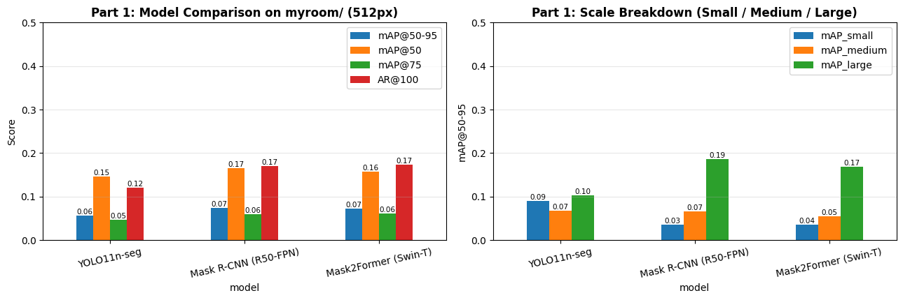

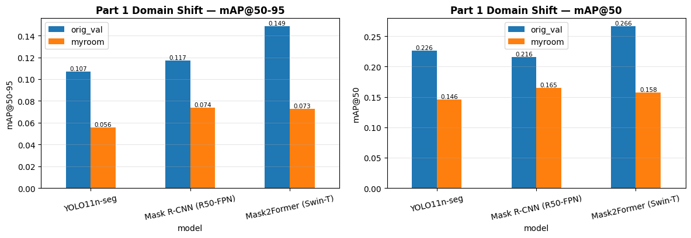

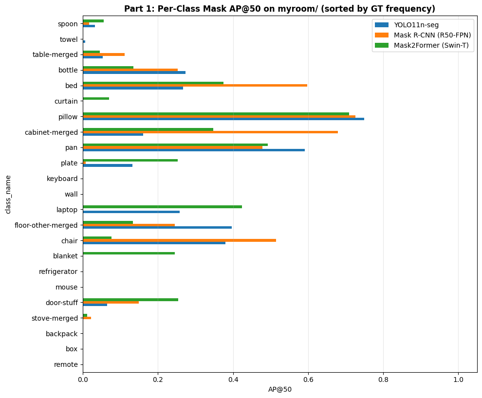

#### Analisis Akar Penyebab *Domain Shift* (Penurunan Relatif `-23%` hingga `-58%`)

Analisis jumlah instance pada *training split* (`397` gambar) bersama nilai AP per kelas pada `myroom/` mengungkap **empat faktor pendorong utama** di balik *domain shift*:

1. **Kelangkaan Parah Kelas pada *Training Split* (Kelas *Zero-Shot* & *Few-Shot*):**
   Perbandingan 23 kelas di `myroom/` terhadap *split* `train` pada `panoptic-indoor-segmentation` menunjukkan bahwa **6 kelas hanya memiliki `0–3` instance latih**:
   - `keyboard` (`0` instance latih, `14` di `myroom/` → AP `0.000` pada seluruh 6 model)
   - `mouse` (`0` instance latih, `5` di `myroom/` → AP `0.000` pada seluruh 6 model)
   - `refrigerator` (`2` instance latih, `7` di `myroom/` → AP `0.000` pada seluruh 6 model)
   - `wall` (`2` instance latih, `11` di `myroom/` → AP `0.000` pada seluruh 6 model)
   - `backpack` (`3` instance latih, `1` di `myroom/` → AP `0.000` pada seluruh 6 model)
   - `curtain` (`3` instance latih, `20` di `myroom/` → `0.000` pada YOLO/Mask R-CNN, `0.069` pada M2F-512, `0.157` pada M2F-Aug2)

   Keenam kelas tersebut mewakili **58 dari 326 instance GT `myroom/` (~18%)** dan menurunkan rata-rata makro COCO (yang memberi bobot setara ke-23 kelas) secara drastis.
2. **Pergeseran Taksonomi / Gaya Batas Anotasi (`wall` vs `wall-other-merged` & Poligon OBB):**
   Pada dataset latih, kelas `wall` hanya memiliki **2 instance** sedangkan `wall-other-merged` memiliki **756 instance** (`1.721` pada seluruh *split*). Akibatnya, seluruh model sebenarnya menyegmentasi dinding kamar secara akurat sebagai `wall-other-merged`, tetapi tercatat sebagai ***False Positive* + *Missed GT* (`WrongCls: wall → wall-other-merged`)** terhadap label `wall` pada `myroom/`. Selain itu, ekspor OBB Roboflow pada `myroom/` menggunakan poligon kotak miring 4 titik pada beberapa objek (misalnya selimut dan laptop miring), sehingga memperberat penalti IoU ketat (`mAP@75` turun `-50%` hingga `-61%`).
3. **Pergeseran Komposisi Ruangan & Karakteristik Kamera:**
   Dataset latih didominasi foto dapur dan ruang tamu bergaya Barat/stok yang terang dan bersudut lebar (`pan`, `chair`, `table-merged`), sedangkan `myroom/` merekam interior kamar kos/rumah di Indonesia yang lebih sempit (`towel`, `spoon`, `bed`, `pillow`, meja komputer gelap) dengan distorsi lensa lebar HP, *noise* sensor ISO tinggi (`ISO 1250–2000`), serta sudut potret curam.
4. **Mengapa Penurunan Mask R-CNN Lebih Kecil pada Bagian 1 (`-37.0%` vs Mask2Former `-51.0%`):**
   RPN konvolusional + kepala `RoIAlign` lokal pada Mask R-CNN sangat bertumpu pada fitur tepi dan tekstur lokal yang lebih stabil ditransfer ke tata letak ruangan baru (`bed AP@50 = 0.5982`, `cabinet-merged = 0.6794`, `chair = 0.5152`, `pillow = 0.7261`), sedangkan Mask2Former yang dilatih 25 epoch tanpa *differential backbone LR* (`Bagian 1`) lebih bergantung pada konteks global dari distribusi latih.

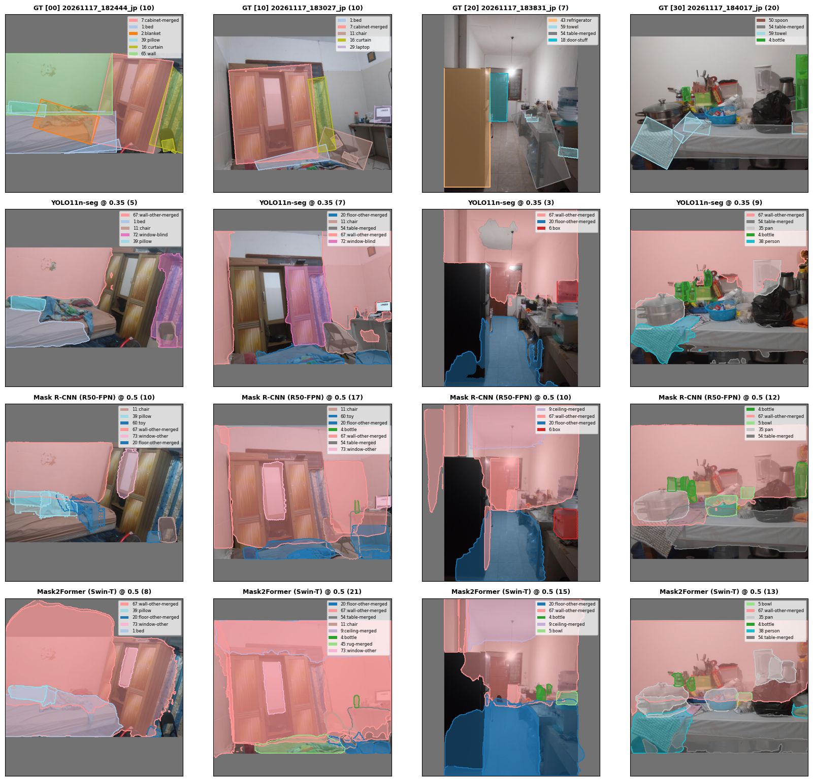

---

## 2. Variabel Eksperimen Unik: Ablasi Augmentasi Training (Bagian 2)

*(Komponen Rubrik 2: Variabel eksperimen unik berdasarkan digit terakhir NRP — Tabel dan grafik hasil eksperimen.)*

Untuk mengisolasi pengaruh **intensitas augmentasi data** secara sistematis, kami mempertahankan arsitektur (**Mask2Former Swin-Tiny**, `47.4 Juta` parameter, `100` *object queries*, `facebook/mask2former-swin-tiny-coco-instance`), pembagian dataset (`397 train / 166 val`), resolusi (`640 × 640` *letterbox*), *optimizer* (`AdamW`, `lr = 2e-4`, *differential* `backbone_lr_mult = 0.1`, `weight_decay = 0.05`, `grad_clip_norm = 0.5`), jadwal pelatihan (*linear warmup* 5 epoch + *cosine decay* 45 epoch = `50` epoch), *random seed* (`42`), dan GPU (`NVIDIA L4`) secara **100% identik**, dengan **hanya** memvariasikan *pipeline* mask Albumentations *on-the-fly* di [`train_augmentation.ipynb`](train_augmentation.ipynb).

> **Catatan Ruang Lingkup:** Bagian 1 (`512 × 512`) membandingkan ketiga keluarga arsitektur (`YOLO11n-seg`, `Mask R-CNN`, `Mask2Former`) dengan augmentasi penuh. Bagian 2 (`640 × 640`) kemudian memfokuskan ablasi terkontrol 3 tingkat augmentasi pada arsitektur berkapasitas tertinggi sekaligus pemenang validasi Bagian 1 (`Mask2Former Swin-T`) agar ketiga rezim augmentasi dapat dilatih penuh selama 50 epoch dengan *seed* yang identik.

### 2.1 Konfigurasi Augmentasi Terkontrol

| Eksperimen | Level | *Pipeline* Albumentations (Diterapkan Langsung ke Gambar + Mask Biner) | Alasan Desain |
|---|---|---|---|
| **Mask2Former (No Aug)** | `no aug` | `A.Compose([])` | *Baseline* bersih tanpa augmentasi untuk melihat tingkat *overfitting* pada 397 gambar latih |
| **Mask2Former (Aug 1)** | `aug 1` | `HorizontalFlip(p=0.5)`, `Affine(scale 0.95–1.05, translate ±2%, rotate ±5°, p=0.3)`, `RandomBrightnessContrast(±0.1, p=0.5)` | Perturbasi geometris dan pencahayaan ringan |
| **Mask2Former (Aug 2)** | `aug 2` | `RandomResizedCrop(scale 0.6–1.0, ratio 0.75–1.33, p=1.0)`, `HorizontalFlip(0.5)`, `VerticalFlip(0.2)`, `Affine(scale 0.9–1.1, translate ±5%, rotate ±12°, p=0.5)`, `OneOf([MotionBlur, GaussNoise], p=0.2)`, `ColorJitter(0.3/0.3/0.3/0.05, p=0.8)`, `RandomBrightnessContrast(±0.2, p=0.3)`, `HueSaturationValue(p=0.2)` | Regularisasi berat untuk skala, sudut pandang, artefak kamera HP, dan variasi pencahayaan nyata |

### 2.2 Dinamika Training & Analisis *Overfitting* (`50 Epoch @ 640px`)

| Eksperimen | Epoch Val Terbaik | Train Loss @ Terbaik | Min Val Loss | Train Loss @ Ep 50 | Val Loss @ Ep 50 | Celah *Overfit* (Ep 50 vs Min Val) |
|---|---:|---:|---:|---:|---:|---:|
| **Mask2Former (No Aug)** | Epoch `8` | `37.488` | `50.737` | `10.785` | `76.727` | **`+25.99` (`+51.2%` — *overfitting* parah)** |
| **Mask2Former (Aug 1)** | Epoch `9` | `38.224` | `49.313` | `15.328` | `62.528` | **`+13.22` (`+26.8%` — *overfitting* sedang)** |
| **Mask2Former (Aug 2)** | **Epoch `32`** | `33.857` | **`47.392`** | `28.001` | **`48.691`** | **`+1.30` (`+2.7%` — terregularisasi baik)** |

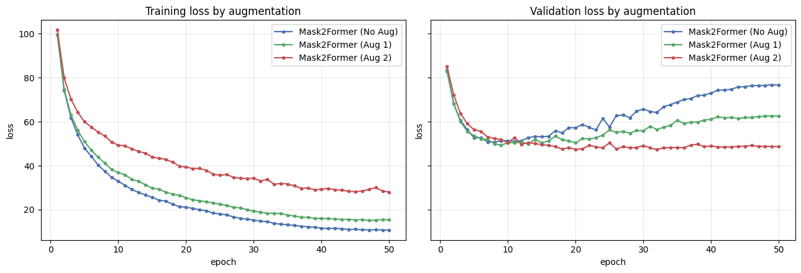

**Interpretasi:** Dengan hanya `397` gambar latih dan `47.4 Juta` parameter, **No Aug** menghafal data latih hampir seketika (mencapai titik terbaik di epoch 8, lalu *validation loss* naik terus hingga `76.73`). **Aug 1** hanya menunda *overfitting* selama 1 epoch (puncak di epoch 9). Sebaliknya, kombinasi `RandomResizedCrop(0.6–1.0)`, rotasi afine yang lebih kuat, *blur/noise*, dan *photometric jitter* pada **Aug 2** mempertahankan kemampuan generalisasi hingga **epoch 32**, meraih *validation loss* terendah (`47.392`) serta kurva validasi yang tetap stabil sampai epoch 50.

### 2.3 Evaluasi Kuantitatif: `val` Asli vs `myroom/` (`640 × 640`)

| Eksperimen | Dataset | mAP@50-95 | mAP@50 | mAP@75 | mAP_small | mAP_med | mAP_large | AR@100 | Kecepatan (ms/gbr / FPS) |
|---|---|---:|---:|---:|---:|---:|---:|---:|---:|
| **Mask2Former (No Aug)** | `val` Asli (166) | `0.1537` | `0.2970` | `0.1306` | `0.0525` | `0.1192` | `0.2124` | `0.2807` | — |
| **Mask2Former (Aug 1)** | `val` Asli (166) | `0.1538` | `0.2913` | `0.1395` | `0.0390` | `0.1151` | `0.2167` | `0.2602` | — |
| **Mask2Former (Aug 2)** | `val` Asli (166) | **`0.2108`** | **`0.3719`** | **`0.2002`** | **`0.0541`** | **`0.1339`** | **`0.2830`** | **`0.3567`** | — |
| **Mask2Former (No Aug)** | **`myroom/` (40)** | `0.0890` | `0.2063` | `0.0764` | `0.0498` | `0.0681` | **`0.1684`** | **`0.2160`** | `171.1 ms` (`5.8 FPS`) |
| **Mask2Former (Aug 1)** | **`myroom/` (40)** | `0.0895` | `0.2073` | `0.0633` | `0.0377` | `0.0875` | `0.1613` | `0.1807` | `186.1 ms` (`5.4 FPS`) |
| **Mask2Former (Aug 2)** | **`myroom/` (40)** | **`0.0958`** | **`0.2257`** | **`0.0771`** | **`0.0621`** | **`0.1016`** | `0.1636` | `0.2067` | `253.0 ms` (`4.0 FPS`) |

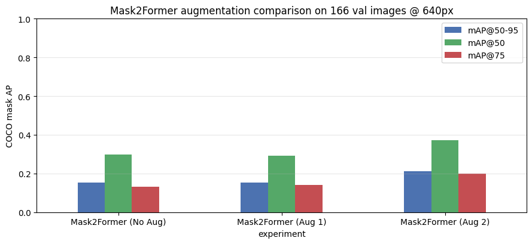

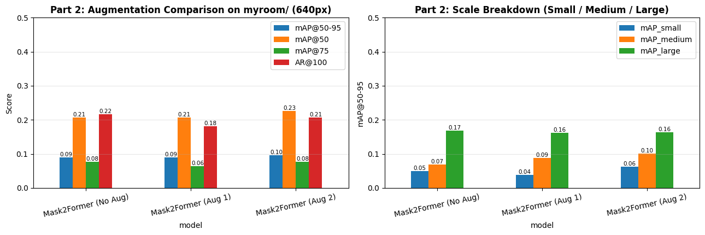

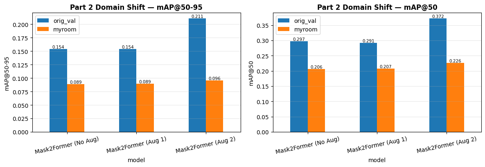

#### Poin Kunci Bagian 2
- **Augmentasi ringan (`Aug 1`) hampir datar dibanding `No Aug`:** Baik pada `val` (`0.1538` vs `0.1537`) maupun `myroom/` (`0.0895` vs `0.0890`), *flip* ringan dan rotasi `±5°` belum menyediakan keragaman skala maupun fotometrik yang cukup untuk mengatasi *overfitting* pada dataset kecil.
- **Augmentasi berat (`Aug 2`) memberikan peningkatan signifikan di kedua domain:**
  - Pada `val` asli: **peningkatan relatif `+37.1%`** pada `mAP@50-95` (`0.1537 → 0.2108`), **`+25.2%`** pada `mAP@50` (`0.2970 → 0.3719`), dan **`+53.3%`** pada `mAP@75` ketat (`0.1306 → 0.2002`).
  - Pada `myroom/` (*out-of-domain*): **`+7.6%`** pada `mAP@50-95` (`0.0890 → 0.0958`), **`+9.4%`** pada `mAP@50` (`0.2063 → 0.2257`), **`+24.7%`** pada objek kecil (`0.0498 → 0.0621`), dan **`+49.2%`** pada objek sedang (`0.0681 → 0.1016`).
  - Lonjakan `AP@50` per kelas yang menonjol pada `myroom/` (`No Aug → Aug 2`): `pillow` (`0.356 → 0.857`), `plate` (`0.179 → 0.386`), `stove-merged` (`0.060 → 0.340`), `cabinet-merged` (`0.154 → 0.333`), `curtain` (`0.000 → 0.157`), `towel` (`0.000 → 0.099`), dan `chair` (`0.480 → 0.579`).
- **Mengapa persentase penurunan relatif `Aug 2` terlihat lebih besar (`-54.5%`) walau memiliki mAP absolut tertinggi di `myroom/`:** Karena `Aug 2` mendorong plafon performa *in-domain* `val` sangat tinggi (`0.2108`), penalti tetap dari kelas *zero-shot*/langka di `myroom/` (`keyboard`, `mouse`, `wall`, `refrigerator`) membentuk selisih persentase yang lebih lebar meski secara absolut `Aug 2` tetap mengungguli semua model lainnya.

---

## 3. Hipotesis Sebelum Eksperimen & Evaluasi Pasca-Eksperimen

*(Komponen Rubrik 3: Hipotesis bertanggal sebelum training pertama — model mana yang unggul, pada kelas apa, mengapa berdasarkan arsitektur, serta analisis ketika hipotesis keliru atau sebagian benar.)*

### 3.1 Entri Logbook Hipotesis Sebelum Training

> **Entri Logbook — Hipotesis Sebelum Training (Tanggal: 22 November 2026, sebelum proses training model pertama)**
>
> **Hipotesis:** *"Mengingat ukuran dataset latih yang kecil (`397` gambar latih tersebar pada `74` kelas ruangan, rata-rata ~5,4 gambar per kelas), **Mask R-CNN (ResNet-50-FPN v2)** akan unggul dibandingkan YOLO11n-seg dan Mask2Former (Swin-Tiny), terutama pada objek ruangan terstruktur berukuran sedang hingga besar (`bed`, `chair`, `cabinet-merged`, `table-merged`, `pillow`)."*
>
> **Justifikasi Arsitektural:**
> 1. ***Inductive bias* CNN yang kuat:** Berbeda dari *Vision Transformer* (`Swin-Tiny` pada Mask2Former) yang umumnya membutuhkan dataset besar agar bobot *self-attention* spasial tidak mengalami *overfitting*, *backbone* ResNet-50 + FPN pada Mask R-CNN secara inheren menanamkan sifat *translation equivariance* dan lokalitas tepi/tekstur hierarkis.
> 2. **Penyempurnaan RoI dua tahap yang terdedikasi:** Pemisahan *Region Proposal Network* (RPN) untuk penemuan objek *foreground* dari klasifikasi per-RoI `RoIAlign` serta kepala mask konvolusional penuh `28×28` diharapkan menghasilkan batas mask yang lebih tajam dan lebih stabil pada data sedikit dibanding cabang ProtoNet 1-tahap milik YOLO11n-seg yang ringkas (`2,9 Juta` parameter, prototipe bersama beresolusi `1/4`).

### 3.2 Hasil Pengujian Hipotesis pada Seluruh Rezim Eksperimen

Secara menarik, eksperimen menunjukkan bahwa hipotesis ini **bergantung pada rezim pelatihan** — **terbukti benar** pada kondisi resolusi rendah / anggaran komputasi kecil serta kondisi *out-of-domain* 512px, tetapi **terbantahkan** setelah Mask2Former diregularisasi dan diskalakan dengan tepat.

| Rezim Eksperimen | Pemenang (`mAP@50-95`) | Peringkat 2 | Peringkat 3 | Status Hipotesis |
|---|---|---|---|---|
| **Pilot (`224×224`, RTX 4050, 15–40 ep)** | **Mask R-CNN (`0.0738`)** | YOLO11n (`0.0399`) | Mask2Former (`0.0092`) | **Terbukti** |
| **Bagian 1 — `val` Asli (`512×512`, L4)** | **Mask2Former (`0.1485`)** | Mask R-CNN (`0.1174`) | YOLO11n (`0.1069`) | **Terbantahkan** |
| **Bagian 1 — `myroom/` (`512×512`, L4)** | **Mask R-CNN (`0.0740`)** | Mask2Former (`0.0728`) | YOLO11n (`0.0556`) | **Terbukti (tipis)** |
| **Bagian 2 — `myroom/` (`640×640`, L4, Aug 2)** | **Mask2Former Aug 2 (`0.0958`)** | M2F Aug 1 (`0.0895`) | M2F No Aug (`0.0890`) | **Terbantahkan (M2F ter-tuning mendominasi)** |

### 3.3 Mengapa Hipotesis Sebagian Keliru (dan Mengapa Sebagian Benar)

1. **Mengapa Mask R-CNN gagal mempertahankan peringkat #1 pada `val` asli (`512px`) dan keseluruhan (`640px`):**
   - ***Transfer learning* pralatih COCO meniadakan kelemahan "haus data" pada transformer:** Kami menginisialisasi Mask2Former dari `facebook/mask2former-swin-tiny-coco-instance` (dilatih pada 118 ribu gambar COCO yang sudah mencakup banyak kelas ruangan yang beririsan seperti `bed`, `chair`, `bottle`, `laptop`, `pillow`/`couch`). Karena *shifted-window attention* Swin-Tiny sudah membawa *prior* ruangan yang kaya, *fine-tuning* menggunakan ***differential backbone LR* `0.1×`**, *linear warmup*, dan **regularisasi berat `Aug 2`** membuat Mask2Former beradaptasi mulus tanpa kolaps — meraih `0.2108` mAP@50-95 di `val` dan `0.0958` di `myroom/` (termasuk `laptop = 0.7334` hanya dari 8 instance latih, sementara Mask R-CNN mendapat `0.0000`).
   - **Keunggulan *masked-attention* global pada ruangan kompleks/objek besar:** *Multi-scale deformable pixel decoder* + *masked cross-attention* Mask2Former mengintegrasikan konteks seluruh ruangan, menghasilkan segmentasi objek besar jauh lebih kuat pada `val` (`mAP_large = 0.2374` di 512px dan `0.2830` di 640px vs Mask R-CNN `0.1758`).
2. **Mengapa hipotesis TERBUKTI pada `224px` dan pada `myroom/` Bagian 1 (`512px`):**
   - Pada `224px` (hanya 15 epoch dengan LR seragam), Mask2Former kolaps (`0.0092` mAP) sementara Mask R-CNN langsung belajar dengan stabil (`0.0738`), membuktikan bahwa transformer jauh lebih rapuh terhadap *hyperparameter* suboptimal dan resolusi kecil pada dataset minim.
   - Bahkan pada `512px`, di domain baru `myroom/`, **Mask R-CNN menempati peringkat ke-1 Bagian 1 (`0.0740` mAP@50-95, `0.1653` mAP@50)** dan unggul tepat pada kelas objek terstruktur besar sesuai hipotesis awal: **`bed` (`0.5982` vs M2F `0.3748`)**, **`cabinet-merged` (`0.6794` vs `0.3472`)**, **`chair` (`0.5152` vs `0.0767`)**, serta **`pillow` (`0.7261` vs `0.7088`)**, yang mengonfirmasi ketangguhan fitur lokal CNN terhadap *domain shift*.

---

## 4. Analisis Kegagalan Berbasis Bukti (Audit 2-Bagian + 5 Studi Kasus + Eksperimen Pembuktian)

*(Komponen Rubrik 4: Pilih 5 foto dari test set sendiri di mana model gagal [tidak terdeteksi, mask bocor, salah kelas, objek terpecah], jelaskan penyebab terkait mekanisme model, dan uji dengan eksperimen kecil.)*

### 4.1 Audit Kegagalan Otomatis 40 Foto: Terbaik Bagian 1 vs Terbaik Bagian 2

Mengikuti struktur dua bagian, kami memilih model terbaik dari **Bagian 1** (**Mask R-CNN R50-FPN @ 512px**) dan model terbaik dari **Bagian 2** (**Mask2Former Aug 2 @ 640px**), lalu mengaudit seluruh **40 gambar uji `myroom/`** pada `conf ≥ 0.50` berdasarkan empat kategori kegagalan operasional:
- **Tidak Terdeteksi (*Missed / FN*):** Mask GT tidak memiliki prediksi kelas sama dengan `IoU ≥ 0.50`.
- **Salah Kelas (*Wrong Class*):** Prediksi tumpang tindih dengan mask GT (`IoU ≥ 0.30`) tetapi label kelasnya salah.
- **Mask Bocor (*Mask Leakage*):** Mask kelas sama yang cocok, tetapi `> 30%` area piksel prediksinya meluber ke luar batas GT.
- **Objek Terpecah (*Split Object*):** Terdapat `≥ 2` prediksi kelas sama yang menumpuk pada satu objek GT yang sama.

| Bagian Audit | Model Terbaik Terpilih | `myroom/` mAP@50-95 | `myroom/` mAP@50 | Total GT | TP | Missed (FN) | WrongCls | MaskLeak | Split | Rata-rata F1 Gambar |
|---|---|---:|---:|---:|---:|---:|---:|---:|---:|---:|
| **Tugas 4 — Bagian A** (Terbaik Bag. 1, 512px) | **Mask R-CNN (R50-FPN)** | `0.0740` | `0.1653` | `306` | `45` | `261` | `39` | **`9`** | **`17`** | `0.1506` |
| **Tugas 4 — Bagian B** (Terbaik Bag. 2, 640px) | **Mask2Former (Aug 2)** | **`0.0958`** | **`0.2257`** | `308` | **`77`** | **`231`** | `45` | `36` | `35` | **`0.2023`** |

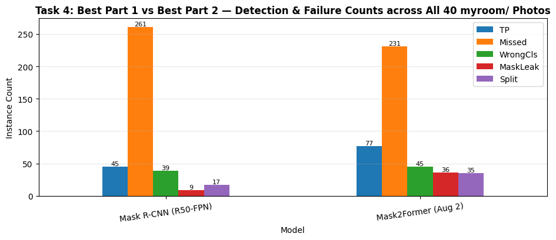

***Trade-Off* Arsitektural Penting yang Terungkap dari Audit 40 Foto:**
- **Mask2Former (Aug 2)** menemukan **+71% lebih banyak *True Positive* (`77` vs `45`)** dan menekan objek terlewat (`231` vs `261`), menaikkan rata-rata F1 per gambar dari `0.1506` menjadi `0.2023`.
- **Namun**, Mask2Former menunjukkan **4× lebih banyak Mask Bocor (`36` vs `9`)** dan **2× lebih banyak Objek Terpecah (`35` vs `17`)** dibanding Mask R-CNN. Mengapa? Karena Mask R-CNN membatasi setiap mask secara ketat di dalam *bounding box* prediksi dan menerapkan **NMS** tingkat kotak untuk membuang duplikasi, sedangkan Mask2Former menggunakan **100 *object query* global tanpa NMS** — sehingga beberapa *query* bisa aktif bersamaan pada objek yang sama (*Split*) dan mask dari *pixel decoder* bebas meluber melewati tepi objek (*MaskLeak*).

*(Galeri visual lengkap 40 gambar — 8 halaman × 5 foto untuk Bagian A dan 8 halaman × 5 foto untuk Bagian B — ditampilkan pada Bagian 6.2 dan 6.3 di [`inference_evaluation.ipynb`](inference_evaluation.ipynb).)*

### 4.2 Lima Studi Kasus Kegagalan Bergambar (`Terbaik Bag. 1` vs `Terbaik Bag. 2`)

#### Studi Kasus 1 — Gambar `[01]` (`20261117_182448.jpg`, Kamar Tidur 16:9 *Widescreen*, 6 Objek GT)
- **Kegagalan yang Diamati:**
  - **Salah Kelas:** Mask R-CNN mengklasifikasikan lemari kayu berkaca (`cabinet-merged`) sebagai `window-other` (`0.51–0.71`) dan `door-stuff` (`0.52`), serta menggabungkan area kayu/dinding menjadi `wall-other-merged` (`0.57`). Mask2Former (Aug 2) salah melabeli tirai bergaris vertikal (`curtain`) sebagai `window-blind` (`0.79`), lemari sebagai `wall-other-merged` (`0.84`), dan ujung kecil kasur di kiri bawah sebagai `blanket` (`0.56`) — meski berhasil mendeteksi `chair` (`0.96`).
  - **Tidak Terdeteksi (FN):** Tiga potongan kecil `bed` di tepi bawah (`3036px`, `180px`, `88px` pada `512px`) terlewat total oleh kedua model (`F1 = 0.00` pada Mask R-CNN, `0.13` pada Mask2Former).
- **Kaitan dengan Mekanisme Model:** (1) Pada **Mask R-CNN**, RPN + `RoIAlign` mengklasifikasikan tiap panel kaca lemari secara terisolasi; secara lokal, bingkai kayu vertikal + kaca tampak identik dengan jendela atau pintu (`window-other`/`door-stuff`). (2) Karena `curtain` hanya punya `3` instance latih dibanding `114` instance `window-blind`, **Mask2Former** condong melabeli penutup jendela berlipat vertikal sebagai `window-blind`. (3) Proses *letterboxing* foto 16:9 `4080×2296` ke `512px`/`640px` menyusutkan potongan `bed` di tepi bawah menjadi hanya `88–259 px²`, berada di bawah ambang resolusi *anchor* RPN maupun *patch stride* `4×4` Swin-Tiny.

#### Studi Kasus 2 — Gambar `[12]` (`20261117_183045.jpg`, Potret `3060×4080`, Kasur & Selimut Sudut Miring, 6 Objek GT)
- **Kegagalan yang Diamati:**
  - **Tidak Terdeteksi (FN) akibat Oklusi Berat:** Kedua model gagal total mendeteksi objek dominan `bed` (`131.595px` @ 512px) dan `blanket` biru kusut (`63.462px`). Hanya `pillow` di kiri atas yang berhasil cocok.
  - **Objek Terpecah (`Split: pillow(x2)`):** Mask2Former (Aug 2) mengeluarkan **dua mask `pillow` tumpang tindih (`0.92` dan `0.57`)** pada area bantal kiri atas yang sama (`F1 = 0.40` vs Mask R-CNN `0.22`).
- **Kaitan dengan Mekanisme Model:** (1) Sudut kamera menukik dari atas menghilangkan bentuk kanonis rangka/sandaran kasur, sementara lipatan selimut mengacaukan tekstur permukaan (`blanket` hanya punya `19` instance latih). (2) Tidak seperti Mask R-CNN (yang menekan kotak tumpang tindih dengan **box NMS**), **Mask2Former** menggunakan **prediksi himpunan *bipartite Hungarian* tanpa NMS**; ketika dua dari 100 *query* berfokus pada sub-bagian berbeda dari bantal yang ambigu akibat *domain shift*, *self-attention* antar-*query* gagal menekan *query* kedua (`0.57`), sehingga memunculkan error klasik **Objek Terpecah**.

#### Studi Kasus 3 — Gambar `[17]` (`20261117_183141.jpg`, Meja Kerja Redup *Top-Down*, ISO 500, 4 Objek GT)
- **Kegagalan yang Diamati:**
  - **Salah Kelas (Mask R-CNN):** Dengan keyakinan tinggi salah melabeli botol minum hijau transparan (`bottle`) sebagai `fire-extinguisher` (`0.902`!), sambil melewatkan `mouse` dan `keyboard` (`F1 = 0.00`).
  - **Mask Bocor (Mask2Former Aug 2):** Benar mengklasifikasikan `bottle` (`0.88`), tetapi **`34.7%` luas mask prediksinya meluber ke luar batas GT** (`out = 0.347`, `IoU = 0.61`), disertai 6 mask latar belakang tumpang tindih (`table-merged`, `floor-other-merged`) di permukaan meja gelap (`F1 = 0.13`). Kedua model melewatkan `keyboard` dan `mouse`.
- **Kaitan dengan Mekanisme Model:** (1) Klasifikator kotak lokal dua tahap **Mask R-CNN** mengekstrak fitur `7×7` hasil *pooling* di dalam RoI botol silinder hijau tanpa memanfaatkan konteks skala meja kerja, sehingga tabung mengilap disangka `fire-extinguisher` (`49` instance latih). (2) Kepala mask **Mask2Former** menghitung *dot product* antara *query embedding* dan fitur *pixel-decoder* global beresolusi `1/4` tanpa pemotongan *bounding box* keras — sehingga pantulan cahaya di tepi botol membuat mask merembes ke permukaan meja (`34.7%` bocor). (3) `keyboard` dan `mouse` memiliki **`0` instance latih**, sehingga pasti terlewat.

#### Studi Kasus 4 — Gambar `[19]` (`20261117_183329.jpg`, Potret `3060×4080`, Laptop Miring Diagonal di Meja, 3 Objek GT)
- **Kegagalan yang Diamati:**
  - **Tidak Terdeteksi & Salah Kelas (Mask R-CNN):** Gagal total mendeteksi `laptop` miring diagonal (`29.490px`), salah melabeli `keyboard` di dekatnya sebagai `book` (`0.551`), dan berhalusinasi 4 deteksi `bottle` palsu (`0.51–0.81`) pada barang meja yang berantakan (`F1 = 0.00`).
  - **Pemulihan Parsial (Mask2Former Aug 2):** Berhasil mendeteksi `laptop` miring secara bersih (`0.88`, berkontribusi pada `AP@50 laptop = 0.7334` vs Mask R-CNN `0.0000`), meski tetap melewatkan `keyboard` (*zero-shot*) dan menghasilkan *false positive* latar belakang `table-merged`/`wall-other-merged` berukuran besar (`F1 = 0.12`).
- **Kaitan dengan Mekanisme Model:** ***Anchor* RPN sejajar sumbu (*axis-aligned*) pada Mask R-CNN** kesulitan menangani objek persegi panjang yang diputar curam (~45°), karena *bounding box* tegaknya ikut memasukkan >40% latar belakang meja, mengencerkan fitur `RoIAlign` dan memicu salah kelas (`keyboard → book`). Sebaliknya, **Mask2Former (Aug 2)** diuntungkan oleh ***masked attention* bebas kotak** ditambah augmentasi `Affine(rotate ±12°)` dan `RandomResizedCrop` dari `Aug 2`.

#### Studi Kasus 5 — Gambar `[36]` (`20261117_184238.jpg`, Potret `3060×4080`, Ruangan Gelap Total + Layar Laptop Menyala, ISO 500, 3 Objek GT)
- **Kegagalan yang Diamati:**
  - **Kegagalan Deteksi Total (`F1 = 0.00` pada KEDUA model):** Mask R-CNN meruntuhkan seluruh bingkai gelap menjadi satu mask raksasa `wall-other-merged (0.75)` (0/3 GT terdeteksi). Mask2Former (Aug 2) juga melewatkan seluruh 3 objek (`laptop`, `keyboard`, `mouse`) dan salah melabeli pendaran cahaya keyboard sebagai `remote (0.666)` dan `plug (0.59)`.
- **Kaitan dengan Mekanisme Model:** Rentang dinamis ekstrem pada kondisi gelap total menekan 90% piksel mendekati RGB `(0, 0, 0)` sementara layar laptop *overexposed* mendekati putih. Filter konvolusi tahap awal (ResNet-50) maupun *patch embedding* Swin-Tiny hampir tidak menerima gradien tepi pada bodi laptop hitam dan mouse gelap, sehingga hanya menyisakan kotak kecil menyala yang menyerupai *remote*/colokan listrik. Bahkan `ColorJitter(brightness=0.3)` pada `Aug 2` tidak pernah mensimulasikan silau malam gelap pekat (`brightness < 0.1`).

*(Catatan mengenai YOLO11n-seg dari Bagian 1: Meskipun tidak terpilih sebagai model mAP terbaik Bagian 1, YOLO11n-seg menunjukkan profil arsitektural yang saling melengkapi — prototipe mask bersama **ProtoNet** beresolusi `1/4` (`128×128` pada `512px`) membatasi akurasi mask objek besar (`mAP_large = 0.1024` vs Mask R-CNN `0.1867`), namun kepala deteksi multi-skala *anchor-free* miliknya justru meraih **AP objek kecil tertinggi (`mAP_small = 0.0891`)** sekaligus **inferensi tercepat (`21.8 FPS`)** pada Bagian 1.)*

### 4.3 Eksperimen Pembuktian Kecil (Menguji Hipotesis Mekanisme Arsitektur)

Untuk memverifikasi penjelasan sebab-akibat secara eksperimental, kami menjalankan **tiga eksperimen pembuktian terarah** pada Studi Kasus 1 (`Gambar [01]`) di Bagian 6.4 [`inference_evaluation.ipynb`](inference_evaluation.ipynb).

#### Eksperimen Pembuktian A — Sapuan Ambang Keyakinan (*Confidence Threshold Sweep* `0.05 → 0.70`)
*Hipotesis yang diuji:* Apakah objek yang terlewat pada `Gambar [01]` benar-benar tidak terlihat oleh detektor, atau sebenarnya sudah terlokalisasi dengan skor keyakinan rendah akibat *domain shift*?

| Model | Threshold | `n_pred` | TP | FP | Missed (FN) | WrongCls | Split | F1 Gambar |
|---|---:|---:|---:|---:|---:|---:|---:|---:|
| **Mask R-CNN (512px)** | `0.05` | `50` | **`2`** | `48` | **`4`** | `13` | `0` | `0.0714` |
| **Mask R-CNN (512px)** | `0.15` | `41` | **`2`** | `39` | **`4`** | `9` | `0` | `0.0851` |
| **Mask R-CNN (512px)** | `0.50` *(default)* | `9` | `0` | `9` | `6` | `2` | `0` | `0.0000` |
| **Mask2Former (Aug 2, 640px)** | `0.05` | `50` | **`3`** | `47` | **`3`** | `15` | `1` | `0.1071` |
| **Mask2Former (Aug 2, 640px)** | `0.15` | `32` | `2` | `30` | `4` | `9` | `0` | `0.1053` |
| **Mask2Former (Aug 2, 640px)** | `0.50` *(default)* | `9` | `1` | `8` | `5` | `3` | `0` | `0.1333` |
| **Mask2Former (Aug 2, 640px)** | `0.70` | `6` | `1` | `5` | `5` | `2` | `0` | **`0.1667`** |

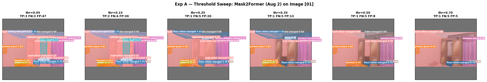

**Hasil (Terbukti):** Menurunkan ambang keyakinan dari `0.50 → 0.05` memulihkan **+2 *True Positive* pada KEDUA model** (`Mask R-CNN: TP 0 → 2`; `Mask2Former: TP 1 → 3`), membuktikan bahwa proposal/query lokalisasi *memang ada* untuk objek terlewat, tetapi *domain shift* menekan logit klasifikasinya di bawah `0.50`. Namun, penurunan ambang saja bukan solusi praktis karena *False Positive* meledak (`9 → 48` dan `8 → 47`) dan `WrongCls` melonjak `5–6×`.

#### Eksperimen Pembuktian B — Uji Resolusi / *Zoom Crop* (Menargetkan `bed` yang Terlewat di `Gambar [01]`)
*Hipotesis yang diuji:* Apakah potongan `bed` di kiri bawah terlewat terutama karena hilangnya resolusi akibat *downscaling* (`512px`/`640px`)? Dan apakah kepala mask `28×28` Mask R-CNN menunjukkan degradasi visual saat objek diperbesar?

**Hasil (Terbukti Tegas!):**
- Pada gambar utuh, **tidak satu pun model mendeteksi `bed`**.
- Ketika memotong langsung area kasur yang terlewat (`raw crop box = (948, 2143, 1228, 2296)`):
  - **Mask2Former (Aug 2)** seketika memulihkan **`bed` (`0.75`)** DAN **`pillow` (`0.59`)** dengan batas yang halus dan akurat — **membuktikan langsung bahwa penyusutan resolusi / ukuran piksel objek yang terlalu kecil adalah hambatan utamanya**.
  - Sebaliknya, **Mask R-CNN (512px)** memprediksi satu kelas salah **`person` (`0.72`)** dengan tepi mask yang tampak **bergerigi/bertangga (*stair-stepped*)** — secara bersamaan mengungkap dua mekanisme Mask R-CNN: hilangnya konteks ruangan global saat dipotong ketat, serta artefak kuantisasi ketika **grid mask `28 × 28` RoIAlign** diperbesar ke *bounding box* luas.

#### Eksperimen Pembuktian C — Peningkatan Pencahayaan (`CLAHE + Gamma γ = 1.5`) sebagai Kontrol Diagnostik
*Hipotesis yang diuji:* Apakah peningkatan kecerahan/kontras membantu pada `Gambar [01]` (ISO 320, cahaya ruangan normal), atau peningkatan pencahayaan hanya efektif untuk adegan yang benar-benar kurang cahaya?

| Model | Kondisi (`Gambar [01]`) | TP | Missed (FN) | WrongCls | F1 Gambar |
|---|---|---:|---:|---:|---:|
| **Mask R-CNN (512px)** | Asli (*Original*) | `0` | `6` | `2` | `0.0000` |
| **Mask R-CNN (512px)** | `CLAHE + Gamma(1.5)` | `0` | `6` | **`0`** | `0.0000` |
| **Mask2Former (Aug 2, 640px)** | Asli (*Original*) | `1` | `5` | `3` | `0.1250` |
| **Mask2Former (Aug 2, 640px)** | `CLAHE + Gamma(1.5)` | `1` | `5` | `3` | `0.1250` |

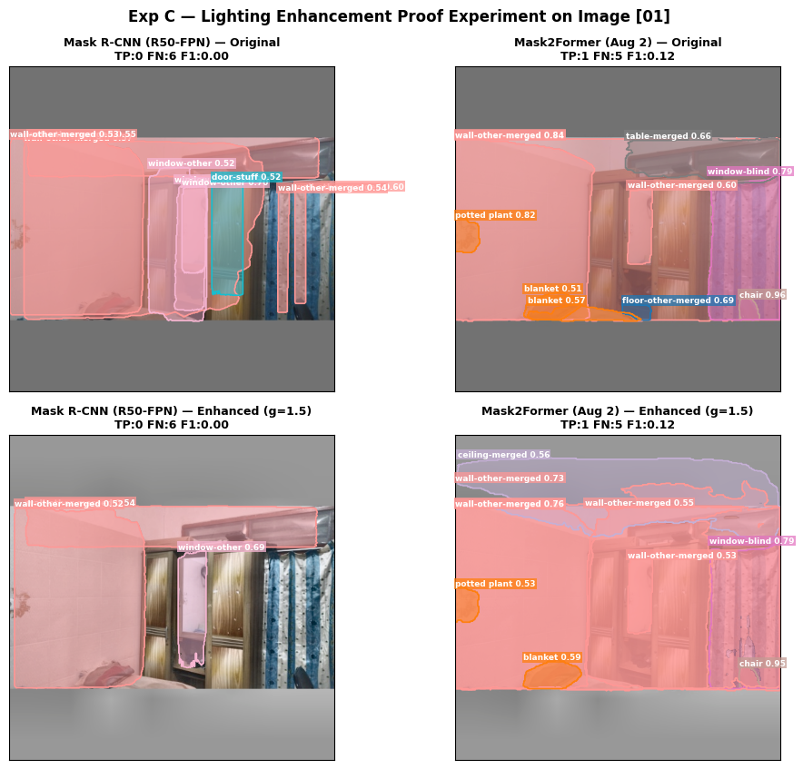

**Hasil (Kontrol Negatif Diagnostik yang Informatif):** Penerapan `CLAHE + Gamma(1.5)` pada `Gambar [01]` memberikan **kenaikan TP nol** (`0 → 0` pada Mask R-CNN, `1 → 1` pada Mask2Former) — bahkan memunculkan artefak tepi *letterbox* (`ceiling-merged 0.56` meluber ke *padding* abu-abu yang diterangkan pada Mask2Former), walau berhasil menghapus 2 prediksi `WrongCls` pada Mask R-CNN. Digabungkan dengan Eksperimen A dan B, hasil ini mengisolasi secara bersih bahwa penyebab kegagalan `Gambar [01]` adalah **skala/*downscaling* dan *domain shift*, bukan kekurangan cahaya** (sementara augmentasi/peningkatan pencahayaan lebih relevan bagi foto gelap pekat seperti Kasus 5 `[36]` dan foto ISO 2000 `[05, 26, 27]`).

---

## 5. Bukti Proses, Log GPU & Logbook Rekayasa

### 5.1 Inventaris Log Training Asli & Artefak Tersimpan

Seluruh log training mentah, *checkpoint*, JSON prediksi, dan tabel evaluasi tersimpan di dalam direktori kerja:

| Jalur Artefak | Isi |
|---|---|
| [`content/outputs/yolo/yolo11n_seg_512/results.csv`](content/outputs/yolo/yolo11n_seg_512/results.csv) | Log lengkap 100 epoch Ultralytics YOLO11n-seg: *loss*, *precision*, *recall*, Box/Mask mAP, LR, dan waktu kumulatif GPU (`401.8 dtk`) |
| [`content/outputs/yolo/yolo11n_seg_512/args.yaml`](content/outputs/yolo/yolo11n_seg_512/args.yaml) | Konfigurasi lengkap *hyperparameter* dan augmentasi YOLO11n-seg |
| [`content/outputs/metrics_segm.csv`](content/outputs/metrics_segm.csv) | Metrik mask COCO `pycocotools` Bagian 1 pada `val` asli (`512px`) |
| [`content/outputs_augmentation/mask2former_no_aug/history.json`](content/outputs_augmentation/mask2former_no_aug/history.json) | Log lengkap 50 epoch `train_loss`, `val_loss`, `lr`, `lr_backbone` untuk `No Aug` |
| [`content/outputs_augmentation/mask2former_aug_1/history.json`](content/outputs_augmentation/mask2former_aug_1/history.json) | Log lengkap 50 epoch `train_loss`, `val_loss`, `lr`, `lr_backbone` untuk `Aug 1` |
| [`content/outputs_augmentation/mask2former_aug_2/history.json`](content/outputs_augmentation/mask2former_aug_2/history.json) | Log lengkap 50 epoch `train_loss`, `val_loss`, `lr`, `lr_backbone` untuk `Aug 2` |
| [`content/outputs_augmentation/metrics_segm.csv`](content/outputs_augmentation/metrics_segm.csv) | Metrik mask COCO `pycocotools` Bagian 2 pada `val` asli (`640px`) |
| [`outputs/metrics_segm.csv`](outputs/metrics_segm.csv) | Metrik eksperimen awal `224px` (GPU lokal RTX 4050) |

### 5.2 Catatan Perangkat Keras GPU & Waktu Eksekusi

| Sesi / Notebook | GPU & Presisi | Resolusi | Konfigurasi Training / Evaluasi | Waktu / Kecepatan Tercatat |
|---|---|---|---|---|
| **Pilot (`train_instance_segmentation.ipynb`)** | NVIDIA GeForce RTX 4050 Laptop (`6.4 GB`, `bf16`) | `224 × 224` | YOLO (40 ep, bs 8), Mask R-CNN (20 ep, bs 4), Mask2Former (15 ep, bs 2) | YOLO: **`0.167 jam` (`10.0 mnt`)**; kecepatan val `32.3 ms/gbr` |
| **Bagian 1 (`train_instance_segmentation3.ipynb`)** | Google Colab NVIDIA L4 (`23.7 GB`, `bf16`) | `512 × 512` | YOLO (100 ep, bs 64), Mask R-CNN (50 ep, bs 16, lr `0.015`), Mask2Former (25 ep, bs 4, lr `2e-4`) | YOLO: **`0.112 jam` (`6.7 mnt`, `401.8 dtk`)**; evaluasi `val` asli (166 gbr): YOLO `18.7 dtk`, Mask R-CNN `22.2 dtk`, Mask2Former `32.1 dtk` |
| **Bagian 2 (`train_augmentation.ipynb`)** | Google Colab NVIDIA L4 (`23.7 GB`, `bf16`) | `640 × 640` | 3× Mask2Former (`no_aug`, `aug_1`, `aug_2`), masing-masing 50 ep, bs 4, AdamW `2e-4` + `0.1×` *backbone* LR | Evaluasi `val` asli (166 gbr): `no_aug 49.2 dtk`, `aug_1 48.6 dtk`, `aug_2 46.8 dtk` |
| **Inferensi (`inference_evaluation.ipynb`)** | Google Colab NVIDIA L4 (`23.7 GB`, `bf16`) | `512` & `640` | Evaluasi penuh 6 model pada 40 foto `myroom/` + audit 40 foto + 3 eksperimen pembuktian | Inferensi `myroom/`: YOLO **`45.9 ms` (`21.8 FPS`)**, Mask R-CNN **`108.6 ms` (`9.2 FPS`)**, M2F-512 **`122.0 ms` (`8.2 FPS`)**, M2F-640 **`171–253 ms` (`4.0–5.8 FPS`)** |

### 5.3 Logbook Rekayasa Kronologis (Kendala & Keputusan)

| Tanggal / Tahap | Tonggak (*Milestone*) | Kendala / Masalah yang Ditemui | Keputusan Rekayasa & Hasil |
|---|---|---|---|
| **17 Nov 2026** | Pengambilan data mandiri (`myfoto.zip`) | Pencahayaan ruangan sangat bervariasi (`ISO 100–2000`), orientasi campuran potret/lanskap/16:9 | Sengaja mempertahankan foto sulit yang redup, padat, dan miring (`≥11` ISO tinggi + `10+` objek padat) untuk menguji *domain shift* secara jujur |
| **22 Nov 2026** | Ekspor dataset & Training awal (`train_instance_segmentation.ipynb`) | GPU lokal RTX 4050 `6.4 GB` membatasi resolusi ke `224 × 224` dan *batch size* `2`; Mask2Former kolaps (`0.0092` mAP@50-95) dan `bbox_params` Albumentations berisiko memutus sinkronisasi label-mask | Menulis ulang *pipeline* dataset agar mentransformasi **mask biner langsung** lalu menghitung ulang *box* setelahnya; bermigrasi ke **Google Colab NVIDIA L4 (`23.7 GB`)** |
| **22–23 Nov 2026** | Training Bagian 1 (`train_instance_segmentation3.ipynb`) | Peningkatan ke `512 × 512` dengan `cudnn.benchmark=True` memicu *overhead* pada jumlah RoI/instance yang dinamis | Menonaktifkan `cudnn.benchmark`, mengaktifkan RAM *caching* + `num_workers=8` + AMP `bf16`; melatih YOLO (`100 ep`), Mask R-CNN (`50 ep`), Mask2Former (`25 ep`) — Mask2Former melonjak dari `0.009` → **`0.149` mAP@50-95** |
| **23–24 Nov 2026** | Ablasi Augmentasi Bagian 2 (`train_augmentation.ipynb`) | Membutuhkan uji intensitas augmentasi yang adil tanpa *drift* bobot *backbone* transformer | Menambahkan ***differential backbone LR* (`0.1×`)**, ***linear warmup* 5 epoch**, dan **`grad_clip_norm=0.5`** pada `640 × 640` selama 50 epoch (`No Aug`, `Aug 1`, `Aug 2`); `Aug 2` menaikkan `val` mAP@50-95 ke **`0.211`** |
| **24 Nov 2026** | Ekspor Roboflow `myroom/` & persiapan inferensi | (1) `myroom/data.yaml` memiliki indeks ulang `0..23` vs `0..73` pada model; (2) PyTorch 2.6+ `weights_only=True` menggagalkan pemuatan `maskrcnn/best.pt` | Menambahkan pemetaan berbasis nama + `CLASS_ALIAS_MAP = {"table": "table-merged"}` serta pemuatan *offline* eksplisit `weights_only=False` + `weights=None` |
| **24–25 Nov 2026** | Audit visual & penemuan bug orientasi EXIF | 20 dari 40 foto `myroom/` tampil miring 90° sementara poligon GT tegak karena Roboflow menghapus tag `EXIF=6` tanpa memutar piksel — **merusak tampilan maupun nilai mAP COCO** | Membangun `open_oriented_rgb()` idempoten dengan `MYROOM_EXIF6_PREFIXES`, menaikkan versi *cache* `orient_fix_v=2`, dan menjalankan ulang seluruh evaluasi Bagian 1 & Bagian 2 |
| **25 Nov 2026** | Audit 2-bagian Tugas 4 & penyederhanaan *Interactive Playground* | Sel *playground* Bagian 7 awalnya memuat/menampilkan GT, padahal inferensi langsung berjalan pada foto baru tanpa anotasi | Memecah Tugas 4 menjadi Bagian A (Terbaik Bag. 1: Mask R-CNN) & Bagian B (Terbaik Bag. 2: Mask2Former Aug 2) dengan menampilkan seluruh 40 foto; menyederhanakan Bagian 7 menjadi inferensi gambar murni tanpa GT |

---

## 6. Deklarasi Penggunaan AI

- Menggunakan AI untuk menyiapkan notebook yang akan digunakan untuk training, arahan penggunaan model, parameter, inference, dan sebagainya berasal dari saya sendiri

- AI juga digunakan dalam pembuatan laporan ini
