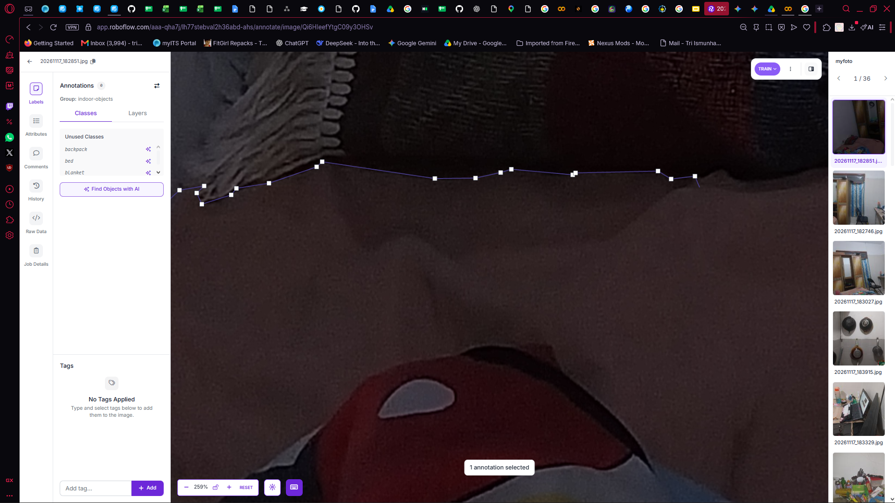
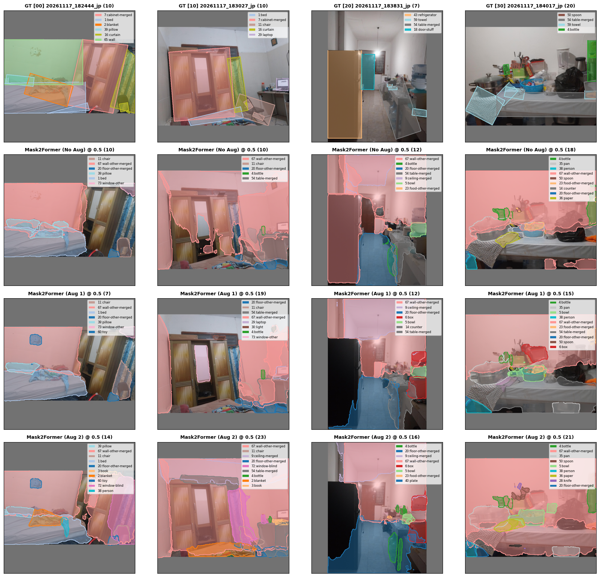
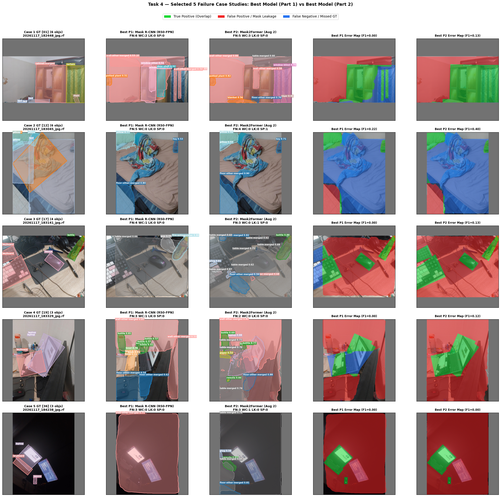
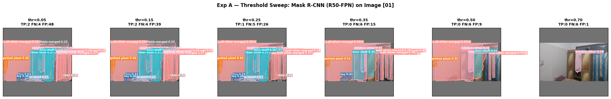
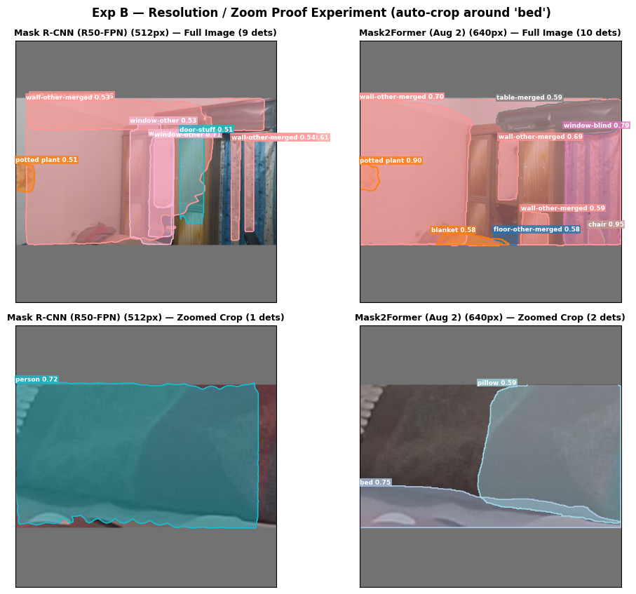

# Laporan Tugas Instance Segmentation

| Keterangan | Detail |
|---|---|
| **Mata Kuliah** | Computer Vision |
| **Nama / NRP** | Tri Ismunhadi Julik Cakra Wibawa / 5054241017 |
| **Tanggal** | 25 November 2026 |
| **Dataset Training** | `panoptic-indoor-segmentation` (Roboflow, 922 gambar: 397 train / 166 val / 359 test, 74 kelas, 11.845 poligon) |
| **Test Set Sendiri** | `myroom/` (40 foto kamera HP, 326 poligon beranotasi mandiri pada 23 kelas terpetakan) |
| **Notebook Utama** | [`train_instance_segmentation3.ipynb`](train_instance_segmentation3.ipynb), [`train_augmentation.ipynb`](train_augmentation.ipynb), [`inference_evaluation.ipynb`](inference_evaluation.ipynb) |
| **Logbook** | [Buka Logbook (Google Docs)](https://docs.google.com/document/d/1xVoxOM6B0qv5s7P6afcPh50272NgS69wQaQmlFs09Bw/edit?usp=sharing) |

---

## Daftar Isi

1. [Test Set Buatan Sendiri & Analisis Domain Shift](#1-test-set-buatan-sendiri-dan-analisis-domain-shift)
   - [1.1 Metadata EXIF & Kondisi Sulit](#11-metadata-exif-dan-kondisi-sulit)
   - [1.2 Bukti Anotasi Roboflow](#12-bukti-anotasi-roboflow)
   - [1.3 Performa Dataset Asli vs Buatan Sendiri](#13-performa-dataset-asli-vs-buatan-sendiri)
2. [Eksperimen Augmentasi](#2-eksperimen-variabel-unik-augmentasi)
3. [Hipotesis Sebelum Eksperimen](#3-hipotesis-sebelum-eksperimen)
4. [Analisis Kegagalan Berbasis Bukti](#4-analisis-kegagalan-berbasis-bukti)
   - [4.1 5 Studi Kasus Kegagalan](#41-5-studi-kasus-kegagalan)
   - [4.2 Eksperimen Pembuktian Kecil](#42-eksperimen-pembuktian-kecil)
5. [Log Training, GPU & Logbook](#5-bukti-proses-log-training-gpu-dan-logbook)
6. [Deklarasi Penggunaan AI](#6-deklarasi-penggunaan-ai)

---

## 1. Test Set Buatan Sendiri dan Analisis Domain Shift

### 1.1 Metadata EXIF dan Kondisi Sulit

Seluruh **40 foto uji** diambil di ruangan nyata (kamar, meja kerja, dapur) menggunakan kamera HP sendiri pada **17 November 2026** (`18:24:46–18:43:37 WIB`). Foto mentah asli beserta metadata EXIF dapat diakses di [Google Drive (Foto Mentah EXIF)](https://drive.google.com/drive/folders/1jO5P1c-z-KQZ7IXXcUkZZy8tK4fMWFmV?usp=sharing).

| Atribut EXIF | Nilai (40 Foto Mentah) |
|---|---|
| **Perangkat / Lensa** | `samsung SM-A236E` (Galaxy A23 5G), `f/1.8`, `4.0 mm` |
| **Resolusi Terorientasi** | `4080×3060` lanskap (16), `3060×4080` potret `EXIF=6` (20), `4080×2296` 16:9 (4) |
| **ISO / Shutter Speed** | ISO `100–2000` (median `400`) · Eksposur `0.02–0.25 dtk` |

**Cakupan kondisi sulit (syarat ≥ 10 foto):**
- **Cahaya redup / gelap:** **11 foto** `ISO ≥ 500` (termasuk 6 foto `ISO 1250–2000` pada indeks `05, 07, 26, 27, 28, 35`) + **1 foto gelap total bersilau layar laptop** (`36`).
- **Shutter lambat:** **17 foto** dengan eksposur `≥ 0.04 dtk`.
- **Oklusi & objek padat:** **10+ foto** berisi `10–30` objek bertumpuk (maks 30 objek pada `[23]`, 20 pada `[30]`, 18 pada `[38]`).
- **Sudut ekstrem:** *top-down* meja (`17, 19, 36`) dan miring curam (`12, 23`).

### 1.2 Bukti Anotasi Roboflow

Ke-40 foto dianotasi manual di Roboflow (`myroom/`, 326 poligon pada 24 kelas). Saat evaluasi di [`inference_evaluation.ipynb`](inference_evaluation.ipynb), kelas dipetakan otomatis berdasarkan nama ke taksonomi latih 74 kelas (`table → table-merged`, menghasilkan **23 kelas aktif**), dan 20 foto potret yang tag `EXIF=6`-nya terhapus saat ekspor Roboflow diputar kembali `90° CW` agar sejajar dengan poligon GT.

### 1.3 Performa Dataset Asli vs Buatan Sendiri

Evaluasi seragam menggunakan `pycocotools` pada `NVIDIA L4 (bf16)` — **Bagian 1 (`512 × 512` letterbox)**:

| Model | Dataset | mAP@50-95 | mAP@50 | mAP@75 | mAP_s | mAP_m | mAP_l | AR@100 | Δ mAP@50-95 | FPS |
|---|---|---:|---:|---:|---:|---:|---:|---:|---:|---:|
| **YOLO11n-seg** | `val` asli (166) | `0.1069` | `0.2265` | `0.0946` | `0.0592` | `0.0992` | `0.1410` | `0.1993` | — | — |
| **YOLO11n-seg** | **`myroom/` (40)** | `0.0556` | `0.1462` | `0.0465` | **`0.0891`** | **`0.0673`** | `0.1024` | `0.1196` | `-48.0%` | **`21.8`** |
| **Mask R-CNN (R50-FPN)** | `val` asli (166) | `0.1174` | `0.2156` | `0.1193` | `0.0375` | `0.0870` | `0.1758` | `0.2104` | — | — |
| **Mask R-CNN (R50-FPN)** | **`myroom/` (40)** | **`0.0740`** | **`0.1653`** | `0.0595` | `0.0349` | `0.0659` | **`0.1867`** | `0.1707` | **`-37.0%`** | `9.2` |
| **Mask2Former (Swin-T)** | `val` asli (166) | **`0.1485`** | **`0.2663`** | **`0.1471`** | `0.0437` | `0.0991` | **`0.2374`** | **`0.2602`** | — | — |
| **Mask2Former (Swin-T)** | **`myroom/` (40)** | `0.0728` | `0.1577` | **`0.0615`** | `0.0361` | `0.0549` | `0.1683` | **`0.1739`** | `-51.0%` | `8.2` |

**Penyebab Utama *Domain Shift* (`-37%` hingga `-51%`):**
1. **Kelas langka/*zero-shot* pada *train split* (397 gambar):** 6 dari 23 kelas `myroom/` hanya punya `0–3` instance latih (`keyboard=0`, `mouse=0`, `refrigerator=2`, `wall=2`, `backpack=3`, `curtain=3`), mencakup ~18% total objek GT `myroom/` dan langsung menjatuhkan rata-rata makro AP.
2. **Pergeseran label & bentuk poligon:** `wall` hanya muncul `2×` di train sedangkan `wall-other-merged` `756×`, memicu salah kelas sistematis `wall → wall-other-merged`; selain itu beberapa anotasi OBB 4 titik pada `myroom/` memperberat penalti IoU ketat (`mAP@75`).
3. **Perbedaan ruangan & kamera:** Ruangan kos/rumah yang sempit, ISO tinggi (`1250–2000`), dan sudut potret curam berbeda dari dataset latih. Mask R-CNN paling tahan di Bagian 1 (`-37.0%`) berkat fitur tepi/tekstur lokal CNN (`bed 0.598`, `cabinet-merged 0.679`, `chair 0.515`).

---

## 2. Eksperimen Variabel Unik Augmentasi

Variabel yang diuji adalah **intensitas augmentasi training** pada **Mask2Former (Swin-T)** (`640×640`, 50 epoch, `AdamW lr=2e-4`, *backbone LR* `0.1×`, 5-epoch warmup, `seed=42`, `NVIDIA L4`) di [`train_augmentation.ipynb`](train_augmentation.ipynb).

| Eksperimen | Pipeline Augmentasi (Albumentations) | Epoch Val Terbaik | Min Val Loss → Ep 50 | `val` mAP@50-95 | `val` mAP@50 | **`myroom/` mAP@50-95** | **`myroom/` mAP@50** |
|---|---|---:|---:|---:|---:|---:|---:|
| **No Aug** | Tanpa augmentasi (`A.Compose([])`) | Ep `8` | `50.74 → 76.73` *(overfit parah)* | `0.1537` | `0.2970` | `0.0890` | `0.2063` |
| **Aug 1** | `HFlip(0.5)`, `Affine(±5°, scale 0.95–1.05)`, `BrightnessContrast(±0.1)` | Ep `9` | `49.31 → 62.53` *(overfit sedang)* | `0.1538` | `0.2913` | `0.0895` | `0.2073` |
| **Aug 2** | `RandomResizedCrop(0.6–1.0)`, `HFlip/VFlip`, `Affine(±12°)`,`MotionBlur/GaussNoise`, `ColorJitter`, `HSV` | **Ep `32`** | **`47.39 → 48.69`** *(stabil)* | **`0.2108`** | **`0.3719`** | **`0.0958`** | **`0.2257`** |

**Kesimpulan:** `Aug 1` terlalu ringan untuk mencegah *overfitting* pada 397 gambar latih, sedangkan **`Aug 2`** memperpanjang generalisasi hingga epoch 32, menaikkan `val` mAP@50-95 sebesar **`+37.1%`** (`0.1537 → 0.2108`), serta meraih skor terbaik di `myroom/` (`mAP@50-95 = 0.0958`, `mAP@50 = 0.2257`, lonjakan besar pada `pillow 0.356→0.857`, `plate 0.179→0.386`, `stove-merged 0.060→0.340`, `curtain 0.000→0.157`).

---

## 3. Hipotesis Sebelum Eksperimen

> **Hipotesis (dicatat sebelum training pertama — 22 Nov 2026):**
> *"Dengan ukuran dataset latih yang kecil (397 gambar, 74 kelas), **Mask R-CNN (R50-FPN v2)** akan unggul—terutama pada objek ruangan terstruktur berukuran sedang-besar (`bed`, `chair`, `cabinet-merged`, `pillow`)—karena *inductive bias* CNN dan tahap RPN + `RoIAlign` lebih stabil pada data sedikit dibanding transformer (`Mask2Former`) maupun model ringan 1-tahap (`YOLO11n-seg`)."*

| Rezim Eksperimen | Pemenang (`mAP@50-95`) | Peringkat 2 | Peringkat 3 | Status Hipotesis |
|---|---|---|---|---|
| **Pilot (`224px`, RTX 4050)** | **Mask R-CNN (`0.0738`)** | YOLO11n (`0.0399`) | Mask2Former (`0.0092`) | **Terbukti** |
| **Bagian 1 — `val` Asli (`512px`)** | **Mask2Former (`0.1485`)** | Mask R-CNN (`0.1174`) | YOLO11n (`0.1069`) | **Terbantahkan** |
| **Bagian 1 — `myroom/` (`512px`)** | **Mask R-CNN (`0.0740`)** | Mask2Former (`0.0728`) | YOLO11n (`0.0556`) | **Terbukti (tipis)** |
| **Bagian 2 — `myroom/` (`640px`, Aug 2)** | **Mask2Former Aug 2 (`0.0958`)** | M2F Aug 1 (`0.0895`) | M2F No Aug (`0.0890`) | **Terbantahkan** |

**Penjelasan:**
- **Mengapa sebagian keliru:** Bobot pralatih COCO (`mask2former-swin-tiny-coco-instance`) sudah membawa *prior* objek ruangan yang kuat; begitu resolusi dinaikkan (`512–640px`) dan dilengkapi *backbone LR* `0.1×` + warmup + `Aug 2`, **Mask2Former** mengungguli Mask R-CNN (bahkan mendapat `laptop AP@50 = 0.733` dari 8 instance latih vs `0.000` pada Mask R-CNN).
- **Mengapa sebagian benar:** Pada resolusi rendah (`224px`) Mask2Former kolaps (`0.0092`) sedangkan Mask R-CNN langsung stabil (`0.0738`), dan pada `512px` *out-of-domain* (`myroom/`), Mask R-CNN tetap #1 Bagian 1 tepat pada kelas terstruktur yang diprediksi (`bed`, `cabinet-merged`, `chair`, `pillow`).

---

## 4. Analisis Kegagalan Berbasis Bukti

### 4.1 5 Studi Kasus Kegagalan

Setelah dilakukan audit pada seluruh **40 foto `myroom/`** untuk model terbaik Bagian 1 (**Mask R-CNN 512px**) dan Bagian 2 (**Mask2Former Aug 2 640px**) di [`inference_evaluation.ipynb`](inference_evaluation.ipynb), dipilih **5 studi kasus kegagalan** berikut:

| Kasus & Foto | Kegagalan Utama | Kaitan dengan Mekanisme Arsitektur |
|---|---|---|
| **Kasus 1 — `[01]`** (Kamar 16:9, 6 GT) | **WrongCls & Missed:** Mask R-CNN melabeli lemari kaca sebagai `window-other`/`door-stuff`; M2F melabeli tirai sebagai `window-blind`; tepi `bed` kecil (`88–259 px²`) terlewat keduanya. | **Mask R-CNN:** klasifikasi lokal per-RoI kehilangan konteks lemari utuh. **M2F:** bias kelas latih (`curtain=3` vs `window-blind=114`). *Downscaling* 16:9→`512/640px` menghilangkan detail objek kecil di tepi. |
| **Kasus 2 — `[12]`** (Kasur miring, 6 GT) | **Missed & Split (`pillow×2`):** `bed` & `blanket` kusut terlewat keduanya; M2F menghasilkan **2 mask `pillow` tumpang tindih** (`0.92` & `0.57`) pada 1 bantal. | **M2F tanpa NMS** (set *Hungarian* 100 *query*): dua *query* aktif pada sub-area bantal yang sama (total `35` *split* vs `17` pada Mask R-CNN yang memakai box-NMS). |
| **Kasus 3 — `[17]`** (Meja redup, 4 GT) | **WrongCls & MaskLeak:** Mask R-CNN melabeli `bottle` hijau sebagai `fire-extinguisher` (`0.902`); M2F benar (`bottle 0.88`) tetapi **34,7% mask bocor** ke meja; `keyboard`/`mouse` terlewat. | **Mask R-CNN:** fitur RoI `7×7` lokal tanpa konteks skala meja. **M2F:** *dot-product* mask global tanpa klip *bounding box* menyebabkan pantulan tepi meluber (total `36` *leak* vs `9` pada Mask R-CNN). `keyboard`/`mouse` = `0` data latih. |
| **Kasus 4 — `[19]`** (Laptop diagonal, 3 GT) | **Missed & WrongCls:** Mask R-CNN melewatkan `laptop` miring ~45° & melabeli `keyboard → book`; M2F Aug 2 berhasil mendeteksi `laptop` (`0.88`). | **Mask R-CNN:** *anchor* RPN tegak (*axis-aligned*) memasukkan >40% latar meja pada objek miring. **M2F Aug 2:** *masked attention* bebas kotak + augmentasi rotasi `±12°`. |
| **Kasus 5 — `[36]`** (Gelap total + silau layar, 3 GT) | **Total Miss (`F1 = 0.00` keduanya):** Mask R-CNN meruntuhkan bingkai menjadi `wall-other-merged`; M2F melabeli pendaran keyboard sebagai `remote`/`plug`. | Piksel gelap mendekati `(0,0,0)` menghapus gradien tepi di lapisan awal ResNet/Swin; *ColorJitter* tidak mencakup kondisi gelap malam bersilau. |

*(Catatan YOLO11n-seg Bagian 1: prototipe **ProtoNet** `1/4`-res `128×128` membatasi akurasi objek besar `mAP_l = 0.1024`, tetapi detektor padat *anchor-free*-nya meraih `mAP_s` tertinggi `0.0891` dan kecepatan tertinggi `21.8 FPS`.)*

### 4.2 Eksperimen Pembuktian Kecil

Dijalankan pada Studi Kasus 1 (`Gambar [01]`) di Bagian 6.4 [`inference_evaluation.ipynb`](inference_evaluation.ipynb):

1. **Exp A — Threshold Sweep (`0.50 → 0.05`):** Kedua model memulihkan **+2 TP** (`Mask R-CNN: 0→2`, `M2F: 1→3`), membuktikan objek sebenarnya terlokalisasi namun skornya ditekan *domain shift*—tetapi menurunkan ambang memicu ledakan FP (`9→48` dan `8→47`).
2. **Exp B — Zoom Crop pada `bed` terlewat:** Saat dipotong ketat ke tepi kasur, **Mask2Former (Aug 2)** langsung mendeteksi **`bed` (`0.75`)** dan **`pillow` (`0.59`)** (membuktikan kegagalan disebabkan *downscaling* resolusi), sementara **Mask R-CNN** salah melabeli `person` (`0.72`) dengan tepi mask bergerigi khas pembesaran **grid `28×28` RoIAlign**.
3. **Exp C — CLAHE + Gamma (`γ=1.5`) sebagai kontrol negatif:** Tidak menambah TP (`0→0` dan `1→1`) pada `Gambar [01]` (ISO 320), memastikan akar kegagalan `Gambar [01]` adalah skala & *domain shift*, bukan kurang cahaya.

---

## 5. Bukti Proses Log Training GPU dan Logbook

- **Logbook Mingguan (Kendala & Keputusan):** [Buka Logbook di Google Docs](https://docs.google.com/document/d/1xVoxOM6B0qv5s7P6afcPh50272NgS69wQaQmlFs09Bw/edit?usp=sharing)

### Log Training Asli

| File Log | Keterangan |
|---|---|
| [`content/outputs/yolo/yolo11n_seg_512/results.csv`](content/outputs/yolo/yolo11n_seg_512/results.csv) & [`args.yaml`](content/outputs/yolo/yolo11n_seg_512/args.yaml) | Log 100 epoch & konfigurasi YOLO11n-seg (`512px`, `401.8 dtk`) |
| [`content/outputs/metrics_segm.csv`](content/outputs/metrics_segm.csv) | Metrik COCO `pycocotools` Bagian 1 (`512px`, `val` asli) |
| [`content/outputs_augmentation/mask2former_no_aug/history.json`](content/outputs_augmentation/mask2former_no_aug/history.json) | Log loss & LR 50 epoch — Mask2Former `No Aug` |
| [`content/outputs_augmentation/mask2former_aug_1/history.json`](content/outputs_augmentation/mask2former_aug_1/history.json) | Log loss & LR 50 epoch — Mask2Former `Aug 1` |
| [`content/outputs_augmentation/mask2former_aug_2/history.json`](content/outputs_augmentation/mask2former_aug_2/history.json) | Log loss & LR 50 epoch — Mask2Former `Aug 2` |
| [`content/outputs_augmentation/metrics_segm.csv`](content/outputs_augmentation/metrics_segm.csv) | Metrik COCO `pycocotools` Bagian 2 (`640px`, `val` asli) |
| [`outputs/metrics_segm.csv`](outputs/metrics_segm.csv) | Metrik pilot awal `224px` (RTX 4050 lokal) |

### Catatan GPU & Waktu Eksekusi

| Notebook | GPU | Resolusi | Konfigurasi & Waktu Tercatat |
|---|---|---|---|
| [`train_instance_segmentation.ipynb`](train_instance_segmentation.ipynb) | RTX 4050 Laptop (`6.4 GB`, `bf16`) | `224px` | Pilot YOLO 40 ep (`10.0 mnt`), Mask R-CNN 20 ep, M2F 15 ep |
| [`train_instance_segmentation3.ipynb`](train_instance_segmentation3.ipynb) | Colab NVIDIA L4 (`23.7 GB`, `bf16`) | `512px` | YOLO 100 ep (`6.7 mnt` / `401.8 dtk`), Mask R-CNN 50 ep, M2F 25 ep; eval `val` 166 gbr: `18.7–32.1 dtk` |
| [`train_augmentation.ipynb`](train_augmentation.ipynb) | Colab NVIDIA L4 (`23.7 GB`, `bf16`) | `640px` | 3× Mask2Former 50 ep (`no_aug`, `aug_1`, `aug_2`); eval `val` 166 gbr: `46.8–49.2 dtk` |
| [`inference_evaluation.ipynb`](inference_evaluation.ipynb) | Colab NVIDIA L4 (`23.7 GB`, `bf16`) | `512/640px` | Inferensi `myroom/`: YOLO `21.8 FPS`, Mask R-CNN `9.2 FPS`, M2F-512 `8.2 FPS`, M2F-640 `4.0–5.8 FPS` |

---

## 6. Deklarasi Penggunaan AI

- Menggunakan AI untuk menyiapkan notebook yang akan digunakan untuk training, arahan penggunaan model, parameter, inference, dan hal-hal yang menyangkut Ide berasal dari saya sendiri

- Menggunakan AI untuk merapikan laporan ini
